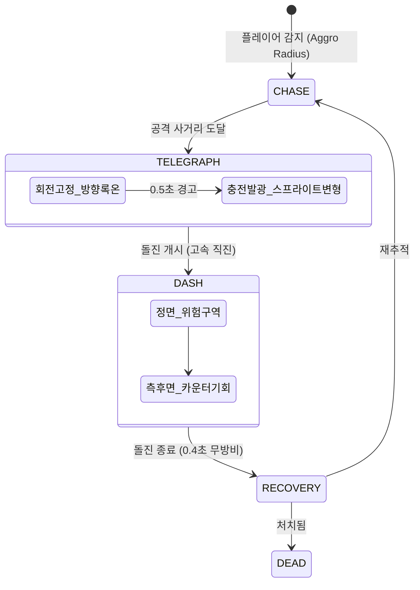
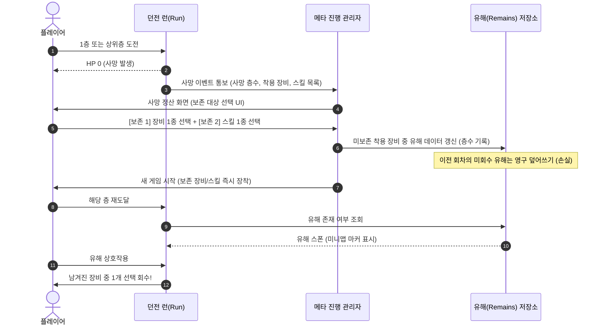
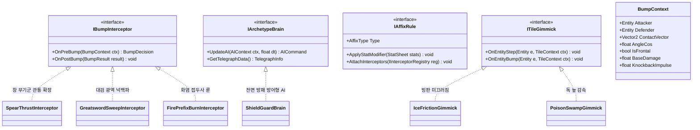

# <Overspire> 지속 발전 가능한 게임 루프 아키텍처 & 에이전트 개발 규약 (ALEP)

> **문서 상태**: Final Blueprint  
> **기준 기획**: `docs/game-design.md` 기반  
> **작성자**: Loop-Driven Architecture Specialist

---

## 1. 아키텍처 개요 및 루프 계층 구조 (Loop Hierarchy)

<Overspire>는 **"이동이 곧 공격"**이 되는 2D 탑다운 범프 액션 로그라이크입니다.  
본 아키텍처는 게임의 생명주기를 5개의 독립적이면서도 유기적인 루프 계층으로 분할하고, 향후 100층, 수십 종의 무기군, 적 아키타입, 룬/접두사 시스템이 확장되더라도 기존 코어 루프를 수정하지 않고 플러그인 형태로 결합되는 **지속 발전 루프(Expansion Loop)**를 보장합니다.

```mermaid
flowchart TD
    subgraph L5["Layer 5: Expansion / Evolution Loop (지속 발전 메타)"]
        EX[무기군 카탈로그 / 룬·접두사 파이프라인 / 층별 기믹 매트릭스 / 몬스터 아키타입]
    end

    subgraph L4["Layer 4: Meta Loop (다회차 보존 & 회수)"]
        ML[사망 초기화 -> 장비/스킬 1종 보존 -> 이전 층 유해(Remains) 단일 회수 -> 해금 풀 확장]
    end

    subgraph L3["Layer 3: Session Loop (2~3분 층 탐험 & 파밍)"]
        SL[절차적 맵 탐색 -> 열쇠 보유 적 격파 -> 1/1 획득 & 계단 활성화 -> 무위험 일시정지 파밍/비교 -> 탈출 vs 잔류 결정]
    end

    subgraph L2["Layer 2: Tactical Loop (5~30초 전술 전투)"]
        TL[적 텔레그래프 식별 -> 선회 속도 허점 공략 -> 측/후면 플랭킹 -> 기술/벨트 사용 -> 무리(Pack) 분리 격파]
    end

    subgraph L1["Layer 1: Micro Loop (0.1~1.0초 범프 & 충돌 피드백)"]
        UL[이동 입력 -> 접촉 각도(내적) 분해 -> 일방 타격 vs 정면 상호 피해 -> 무-무적 분리 임펄스 -> 히트스탑 & 쿨다운]
    end

    EX -.인젝션 및 규칙 주입.-> L1
    EX -.인젝션 및 규칙 주입.-> L2
    EX -.인젝션 및 규칙 주입.-> L3
    EX -.인젝션 및 규칙 주입.-> L4

    L1 --> L2
    L2 --> L3
    L3 --> L4
```

---

## 2. 5-Layer 게임 루프 정밀 설계

### 2.1 Micro Loop (0.1s ~ 1.0s): 범프 전투 물리학 & 임팩트 피드백

Micro Loop는 조작감과 전투의 물리적 쾌감을 결정하는 최하위 루프입니다. 일반 액션 게임의 "공격 버튼"을 대체하여, 플레이어의 이동 속도 벡터와 적의 방향 벡터 간 기하학적 접촉을 실시간 해석합니다.

#### (1) 각도 판정 수학 모델 (Kinematic Angle Resolution)
- **방향 벡터**:
  - 적 전방 방향 단위 벡터: $\vec{F}_{target}$ (적의 `FacingDirection`)
  - 플레이어 충돌 접근 단위 벡터: $\vec{V}_{contact} = \text{normalize}(\vec{P}_{hero} - \vec{P}_{target})$
- **충돌 각도 평가 ($\cos \theta$)**:
  $$\cos \theta = \vec{F}_{target} \cdot \vec{V}_{contact}$$
  - $\theta$는 적의 정면 시선과 플레이어가 들이받은 접촉각 사이의 각도입니다.
- **판정 분기 (`Advantage` vs `Frontal Clash`)**:
  - **정면 충돌 (Frontal Clash)**: $\cos \theta \ge \cos(45^\circ) \approx 0.707$ (적의 전방 $90^\circ$ 원뿔 내부)
    - 판정: **상호 피해(Mutual Damage)**. 적과 용사 모두 피해를 입음.
    - 피드백: 용사 스프라이트 점멸(Flash 3~5프레임), 경고성 피격음.
  - **유리한 각도 (Advantageous Flank / Rear)**: $\cos \theta < \cos(45^\circ)$ (적의 측면 $270^\circ$)
    - 판정: **일방 타격(Unilateral Strike)**. 용사는 0 피해, 적에게만 피해 부여.
    - 피드백: 적에게 큰 넉백, 임팩트 스파크, 타격 SFX, 1~2px 마이크로 화면 쉐이크.

#### (2) 피해 계산 공식 (Damage Dynamics)
고정 타격 횟수가 아닌 스탯 기반 연속성 감쇄 공식을 적용합니다:
$$\text{Damage} = \max\left(1, (\text{Atk} \times \text{SkillMult} - \text{Def} \times 0.5) \times \text{CritMultiplier}\right)$$
- 치명타(Crit): $\text{Random}(0, 1) < \text{CritRate}$ 일 때 $\text{CritMultiplier} = 1.5$ (기본값).

#### (3) 무-무적(No i-frame) 원칙과 겹침 방지 분리 임펄스
기획서 상 **"피격 후 무적 시간 없음"** 원칙을 시스템적으로 실현하기 위해 다단히트 버그를 물리적으로 차단합니다:
1. **Separation Impulse (물리 밀어내기)**: 충돌 즉시 두 콜라이더의 침투 심도(Penetration Depth)를 보정하고, 즉시 반대 방향으로 밀어내는 분리 임펄스 $\vec{I}_{sep}$ 부여.
2. **Bump Attack Cooldown (개별 엔티티 쿨다운)**:
   - 플레이어는 공격 속도($AtkSpd$)에 반비례하는 `AttackCooldownTimer`를 가짐:
     $$\text{CooldownTime} = \frac{\text{BaseCooldown}(0.35s)}{1.0 + \text{AtkSpdBoost}}$$
   - 쿨다운 중 적과 다시 닿더라도 **피해 판정은 스킵**되며, 단순 탄성 충돌(Rigid Separation)만 발생하여 무적 시간 없이도 틱당 중복 데미지가 발생하지 않습니다.
3. **Hitstop (Micro-Freeze)**:
   - 유효 타격 시 0.04초(2~3프레임)간 엔진 시뮬레이션 틱을 일시정지하여 묵직한 손맛 구현 (단, 렌더링 쉐이커는 지속).

---

### 2.2 Tactical Loop (5s ~ 30s): 적 패턴, 포지셔닝 & 팩 전투

Tactical Loop는 슬라임 등 적의 예고 행동을 읽고, 위치를 선점하여 1~3마리의 무리를 요리하는 전술적 호흡입니다.



#### (1) 조작 가능한 허점 설계: 선회 속도(Turn Rate) 제한
- 슬라임은 플레이어를 무조건 즉각 바라보지 않습니다. 초당 각속도 $\omega_{turn} = 120^\circ/s$로 제한됩니다.
- 플레이어는 원형 기동(Orbital Strafing)을 통해 슬라임의 시선 축을 벗어나 측면 각도를 선점할 수 있습니다.

#### (2) 텔레그래프 및 카운터 윈도우 (Telegraph & Counter Window)
- **Telegraph 단계**: 슬라임이 돌진 방향을 고정(Lock-in)하고 몸체를 수축하며 밝은 경고 색상으로 점멸(0.5초).
- **Dash 단계**: 고속 이동. 이 경로의 정면에 서 있으면 상호 피해가 발생하므로 회피 필요.
- **Recovery 단계**: 돌진 직후 0.4초간 정지 및 조작 불능. 확정적인 일방 타격 찬스 제공.

#### (3) 포위 위험도(Surround Danger) 및 기술/벨트 전술
- 슬라임 2~3마리가 협공할 때 한쪽을 치면 다른 쪽의 정면 경로에 노출될 수 있음.
- **기술 슬롯 (2개, 충전식 5~10회)**: 범위 넉백, 대시 관통 등을 통해 포위망 강제 해제.
- **벨트 물약 (4칸)**: 실시간 교전 중 빠른 체력 복구. (음식은 필드 자동 섭취).

---

### 2.3 Session Loop (2m ~ 3m): 절차적 층 탐험, 파밍, 리스크/리워드

한 층의 목표 플레이 시간은 2~3분이며, 탐험과 생존, 파밍의 밀도 높은 압축 경험을 제공합니다.

#### (1) 절차적 위상 생성 (Procedural Topology & Connectivity)
- **맵 생성기 규약**:
  - 방-복도 그래프 생성 시 신장 트리(Spanning Tree)에 추가 순환 경로(Cycle edge)를 더해 막다른 골목과 순환로가 유기적으로 배치되도록 구성.
  - **도달성(Reachability) 불변식**: `StartRoom -> KeyRoom/KeyEnemy -> ExitRoom(Stairs)` 경로가 항상 유효함을 A* 탐색으로 검증한 후 맵 확정.

#### (2) 1/1 열쇠 경제 (Single Key Economy)
- 층당 열쇠는 엄격히 1개 존재.
- 1층에서는 특정 슬라임이 보유(외형상 드러나지 않아 탐색 유도).
- 처치 즉시 자동 습득 (`HUD: Key 1/1`), 계단 개방.

#### (3) 무위험 일시정지 비교 파밍 (Zero-Risk Pause Looting)
- 장비 드롭 시 필드에서 아이템 탭 또는 상호작용 버튼 입력.
- **Game Freeze**: 비교 팝업이 뜨는 순간 모든 몬스터 AI, 물리, 투사체 시뮬레이션 완전 일시정지.
- **6개 슬롯**: 무기, 갑옷, 투구, 신발, 장신구, 방패.
- 교체 시 기존 장비는 바닥으로 낙하. 층을 떠나면 바닥 장비 영구 소멸.

#### (4) 탐욕 vs 탈출 의사결정 (Greed vs. Exit Tension)
- 계단이 열린 순간 플레이어의 딜레마:
  - **탈출**: 현재 체력을 보존하고 안전하게 클리어(층간 자동 회복이 없으므로 HP 보존이 극도로 중요).
  - **탐욕**: 남은 방을 뒤져 상자, 추가 장비, 회복 음식/성소를 탐색하지만 사망 위험 상존.

---

### 2.4 Meta Loop: 다회차 보존 및 유해(Remains) 회수

사망 시 모든 세션 진행(골드, 일반 장비)은 초기화되지만, 플레이어의 숙련도와 전략적 자산은 다음 회차로 영속 전파됩니다.



- **보존 장비 장착 규칙**:
  - 기본 장비(한손검, 가죽 신발)와 슬롯이 겹치면 기본 장비를 대체하여 착용.
  - 빈 슬롯(갑옷, 투구, 방패 등)이면 해당 슬롯에 바로 장착.
- **장기 해금 메타**:
  - 5/15/25층: 기술의 성소에서 첫 선택 시 해당 스킬이 전체 드롭/상점 풀에 영구 등록.
  - 10/20/30층: 보스 첫 격파 시 보스 전용 장비 영구 해금.

---

### 2.5 Expansion / Evolution Loop: 지속 발전 플러그인 아키텍처

향후 100층, 수십 종의 무기군(창, 대검, 단검, 철퇴), 접두/접미 룬 시스템, 환경 기믹이 추가될 때 **Micro/Tactical 코어를 1줄도 수정하지 않는 개방-폐쇄 원칙(OCP)** 아키텍처입니다.



#### 확장 파이프라인 작동 흐름
1. **무기군 확장 (Weapon Interceptor)**:
   - `Spear`: 충돌 각도 임계값을 $45^\circ$에서 $75^\circ$로 확장(사거리 우위 판정)하고 넉백 거리 1.5배 증가.
   - `Dagger`: 후방 $60^\circ$ 공격 시 백스탭 치명타 피해 300% 부여.
   - `Greatsword`: 충돌 성공 시 주변 반경 1.5타일 적들에게 광역 넉백 충격파 전파.
2. **접두사/접미사 룬 시스템 (Affix Chain)**:
   - 아이템 생성 시 `Affix` 목록이 부여됨.
   - 아이템 장착 시 `AttachInterceptors`를 호출하여 플레이어의 `BumpPipeline`에 훅을 등록:
     - *접두사 [타오르는]*: `OnPostBump` 시 대상에게 3초간 화염 도트 부여.
     - *접미사 [흡혈의]*: `OnPostBump` 적 처치 판정 시 용사 HP 5 회복.
3. **환경 기믹 (Tile Gimmick Grid)**:
   - 층별 타일맵의 각 타일에 `ITileGimmick` 장착.
   - 플레이어의 물리 이동 엔진(`MovementComponent`)은 타일의 마찰 계수 및 진흙/얼음 인터페이스를 쿼리하여 속도 벡터를 보정할 뿐, 특수 분기문(`switch (currentFloorTheme)`)을 일체 작성하지 않음.

---

## 3. 소프트웨어 아키텍처 계약 (Clean OOP & Event Pipeline)

게임 엔진(Godot/Unity/Custom)에 비종속적인 클린 C#/TypeScript 스타일 인터페이스 명세입니다.

### 3.1 코어 인터페이스 정의

```csharp
// 1. 범프 충돌 데이터 컨텍스트
public sealed class BumpContext
{
    public ICombatEntity Hero { get; set; }
    public ICombatEntity Monster { get; set; }
    public Vector2 ContactVector { get; set; }
    public Vector2 MonsterFacing { get; set; }
    public float AngleCos { get; set; }
    public bool IsFrontalClash { get; set; }
    public float CalculatedHeroDamage { get; set; }
    public float CalculatedMonsterDamage { get; set; }
    public float KnockbackForce { get; set; }
    public bool CancelBump { get; set; }
}

// 2. 마이크로 루프 인터셉터 (무기, 룬, 패시브 플러그인)
public interface IBumpInterceptor
{
    int ExecutionOrder { get; }
    void OnPreCalculate(BumpContext context);
    void OnPostExecute(BumpContext context, in BumpResult result);
}

// 3. 몬스터 아키타입 AI 두뇌
public interface IArchetypeBrain
{
    void Initialize(IMonsterEntity self);
    void TickBrain(float delta, in HeroObservation heroObs);
    MonsterTacticalState CurrentState { get; }
    TelegraphVisualData CurrentTelegraph { get; }
}

// 4. 유해(Remains) 영속성 데이터 인터페이스
public interface IRemainsStore
{
    int FloorNumber { get; }
    IReadOnlyList<EquipmentItemData> StoredItems { get; }
    Vector2 DropPosition { get; }
    bool IsRecovered { get; }
    void MarkRecovered();
}
```

### 3.2 분리된 이벤트 파이프라인 (Decoupled Event Stream)

계층 간 의존성을 단절하기 위해 루프 간 통신은 순수 이벤트 버스를 통해서만 발생합니다:

```csharp
// Micro -> Tactical
public readonly struct EntityBumpedEvent { public EntityId Attacker; public EntityId Defender; public bool IsFlank; }

// Tactical -> Session
public readonly struct MonsterKilledEvent { public EntityId MonsterId; public bool HasKey; public Vector2 Position; }

// Session -> Meta
public readonly struct SessionEndedEvent { public bool Cleared; public int Floor; public CauseOfDeath Cause; }
```

---

## 4. 에이전트 루프 엔지니어링 프로토콜 (ALEP: Agent Loop Engineering Protocol)

AI 코딩 에이전트들이 기능 구현 시 스코프를 건너뛰거나, 하위 검증 없이 복잡한 상위 시스템을 만들어 아키텍처를 붕괴시키는 것을 방지하는 엄격한 프로토콜입니다.

### 4.1 핵심 불변 원칙 (The Core Commandments)

0. **루프 단위 독립 브랜치 격리 (Branch-per-Loop Isolation)**:
   - 각 루프 계층(Layer) 작업 또는 세부 기능 구현에 착수하기 전, 반드시 최신 기준 브랜치에서 해당 루프 전용 브랜치를 새로 생성(`git checkout -b loop/<layer-name>`)하고 전환한 후 작업한다.
   - `main` 브랜치에 직접 코드를 커밋하거나 검증되지 않은 코드를 푸시하는 행위를 엄격히 금지한다.
   - 해당 루프의 독립 테스트 하네스가 100% 통과(Green)하고 검증이 완료된 시점에만 상위 브랜치로 병합(Merge)한다.
1. **상향식 선행 검증 원칙 (Bottom-Up Verification Only)**:
   - 하위 루프의 단위 하네스가 100% 그린(통과)되지 않으면 상위 루프 코드를 1줄도 작성할 수 없다.
   - Micro(각도 충돌/무-무적 분리) 미완성 상태에서 Slime AI(Tactical) 작성 금지.
   - Tactical(단일/무리 전투) 미검증 상태에서 던전 생성(Session) 작성 금지.
2. **루프 관심사 분리 및 단방향 의존성 (Loop Separation of Concerns)**:
   - 하위 루프는 절대로 상위 루프의 클래스나 상태를 import/reference 하지 않는다.
   - `core/physics/bump`는 `monsters/slime`이나 `dungeon/floor`의 존재를 몰라야 한다. 오직 `ICombatEntity`와 벡터 수학만 처리한다.
3. **독립 격리 테스트 하네스 의무화 (Isolated Test Harness Requirement)**:
   - 모든 루프는 게임 씬 전체를 구동하지 않고도 터미널/헤드리스 환경에서 실행 가능한 독립 테스트 러너를 동봉해야 한다.
4. **비침습적 확장 규약 (Non-Invasive Extension - Zero Core Switch)**:
   - 새로운 몬스터, 무기, 룬, 층 기믹을 추가할 때 코어 루프 엔진 파일(`BumpResolver.cs`, `DungeonManager.cs`) 내부의 `switch-case`나 `if-else`를 수정하는 행위를 엄격히 금지한다.
   - 확장은 반드시 `Registry.Register<T>()` 또는 인터페이스 구현체 주입으로만 수행한다.
5. **UI 및 일시정지(Zero-Risk Pause) 불변식**:
   - 인벤토리 및 바닥 장비 비교 UI가 열릴 때, 물리/AI 시뮬레이션 루프는 반드시 완전히 일시정지되어야 한다.
   - 플레이어가 아이템을 비교하는 동안 적이 다가오거나 피해를 입히는 코드는 치명적 결함(Defect)으로 간주한다.
6. **루프 완료 전 사람(사용자) 웹 플레이테스트 의무화 (Human-in-the-Loop Web Playtest Gate)**:
   - 게임 개발 엔진은 **Godot(고닷)**을 사용한다.
   - 단위/독립 테스트 통과 후 곧바로 완료 및 병합을 선언하는 것을 엄격히 금지한다.
   - 각 루프 완료 전, 반드시 Godot 웹(HTML5/Web) 빌드를 생성하고 로컬 웹 서버를 구동하여 `http://localhost:<포트>` 링크를 사용자에게 제공해야 한다.
   - 사람이 직접 브라우저(로컬호스트)에서 조작감과 재미를 테스트하고 최종 승인(Approval)을 내린 경우에만 해당 루프의 완료 및 상위 브랜치 병합을 진행할 수 있다.

---

## 5. 결론

본 아키텍처는 <Overspire> 기획서의 핵심 제약 사항(범프 각도 판정, 무-무적 분리 임펄스, 1/1 열쇠, 무위험 장비 비교, 유해 회수)을 빈틈없이 만족하며, 게임이 지속 발전할 수 있는 강력한 플러그인 기반 설계를 제공합니다.
