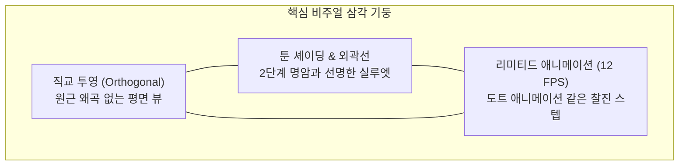

# <Overspire> 3D 로우폴리 2.5D 비주얼 스타일 가이드

> **문서 상태**: 공식 디자인 가이드 초안 (v1.0)  
> **적용 엔진**: Godot 4.x (Compatibility / WebGL 2.0 렌더러)  
> **스타일 정의**: 로우폴리 2.5D 탑다운 디오라마 (Stylized Low-Poly 2.5D)

---

## 1. 비주얼 콘셉트 & 핵심 목표

<Overspire>는 **"3D 모델로 빚어낸 2D 카툰/도트 게임의 감성"**을 지향합니다.  
3D 엔진의 유연함(360도 자유 회전, 입체 타격감, 효율적인 1개 모델 워크플로우)을 취하되, 시각적으로는 클래식 탑다운 액션 어드벤처 특유의 아기자기하고 평면적인 재미를 전달합니다.



---

## 2. 카메라 & 화면 셋업 (Camera & Viewport)

2D 느낌을 형성하는 가장 핵심적인 기반은 **원근 왜곡을 제거한 카메라 앵글**입니다.

### 2.1 카메라 사양 (`Camera3D`)
- **투영 방식 (Projection)**: `Orthogonal(직교 투영)`
- **카메라 각도 (Rotation)**:
  - **Pitch (X축 회전)**: `-55° ~ -60°` (약간의 깊이감이 드러나는 클래식 탑다운 틸트)
  - **Yaw (Y축 회전)**: `0°` (정면 지향) 또는 `45°` (정통 쿼터뷰) — *1차 데모는 직관적인 상하좌우 조작을 위해 `0°` 권장*
  - **Roll (Z축 회전)**: `0°`
- **카메라 크기 (Size / ViewSize)**: `28.8` (플레이테스트 검증 2배 줌아웃 표준: 넓은 시야에서 던전 룸과 다수의 적 팩 전투를 쾌적하게 조망)
- **카메라 추적**: 플레이어 좌표를 부드러운 감쇠(Smooth Damping, `lerp` 가중치 0.1)로 추적하며, 범프 타격 시 순간적인 화면 흔들림(Camera Shake) 적용.

### 2.2 렌더링 해상도 & 스케일링
- **기본 가상 해상도 (Viewport)**: `640 × 360` 또는 `960 × 540` (16:9 기준)
- **화면 모드**: `stretch/mode = "canvas_items"`, `stretch/aspect = "expand"`
- **텍스처 필터링**: `Nearest(최근접 이웃)` — 로우폴리 텍스처 가장자리가 뭉개지지 않고 선명하게 유지되도록 설정.

---

## 3. 3D 모델링 & 지오메트리 규격 (Geometry Standards)

극단적으로 가볍고 단순한 기하학적 형태(Silhouette)를 사용하여, 멀리서 보아도 캐릭터와 적의 상태를 즉각 식별할 수 있어야 합니다.

### 3.1 폴리곤 예산 (Triangle Budget)

| 분류 | 모델 항목 | 권장 트라이앵글(Tri) 수 | 비고 |
| :--- | :--- | :--- | :--- |
| **캐릭터** | 용사(주인공) | 400 ~ 800 Tri | 단순한 원통형 몸체, 투구/검 실루엣 강조 |
| **몬스터** | 기본 슬라임 | 120 ~ 250 Tri | 부드러운 큐브 또는 반구 형태 (Squash용) |
| **몬스터** | 열쇠(왕관) 슬라임 | 200 ~ 350 Tri | 머리 위에 황금 왕관 추가, 스케일 1.2배 |
| **환경** | 바닥/벽 타일 유닛 | 2 ~ 12 Tri (타일당) | 모듈러 1m×1m 큐브/평면 메쉬 |
| **오브젝트**| 상자, 계단, 유해(묘비) | 50 ~ 200 Tri | 굵직하고 명확한 직육면체 기반 실루엣 |

### 3.2 그리드 & 스케일 불변식
- **1 그리드 단위 = 1.0m (미터)**
  - 표준 타일 1칸: `1.0m × 1.0m`
  - 플레이어 신장: 약 `1.1m ~ 1.2m`
  - 슬라임 크기: 기본 반경 `0.45m` (높이 `0.6m`)
  - 벽 높이: `1.5m ~ 2.0m` (탑다운 시야를 가리지 않도록 남쪽 벽은 낮추거나 단면 처리)
- **포맷**: glTF 2.0 바이너리 (`.glb`) 표준 사용.

---

## 4. 셰이딩, 머티리얼 & 컬러 팔레트 (Shading & Color)

복잡한 실사 텍스처(노멀맵, 거칠기 등)를 완전히 배제하고, **단색 면과 굵은 외곽선**으로 2D 일러스트 느낌을 완성합니다.

### 4.1 툰 셰이더 (Toon / Cel-Shading)
- **빛 계산**: 2단계(Banded) 라이팅
  - 빛을 받는 면: 기본 색상 (100% 밝기)
  - 그림자 진 면: 지정된 섀도우 틴트 (70~75% 밝기, 살짝 푸른빛/보랏빛 가미)
- **스페큘러(하이라이트)**: 비활성화 또는 애니메이션 스타일의 딱딱한 원형 도트 하이라이트.

### 4.2 인버티드 헐 외곽선 (Inverted Hull Outline)
- 캐릭터와 주요 몬스터 메쉬의 `Next Pass`에 외곽선 머티리얼을 적용합니다.
- **방식**: 버텍스 노멀 방향으로 메시를 0.02m 확장하고, 전면 컬링(`cull_front`) 처리하여 검은색/어두운 톤으로 단색 렌더링.
- **효과**: 손으로 딴 듯한 짙은 만화책 외곽선이 생성되어 배경과 확실히 분리됨.

### 4.3 통합 단색 컬러 팔레트 (Shared Color Palette)
- 모델마다 개별 텍스처를 쓰지 않고, **64×64 픽셀의 공용 팔레트 PNG 1장**으로 게임 내 모든 에셋의 UV를 매핑합니다.
- **기본 컬러 톤 매트릭스**:
  - **용사(주인공)**: 청색(Cobalt Blue) 갑옷 + 금발/스킨 + 은빛 강철 검 (고전 판타지 영웅 배색)
  - **일반 슬라임**: 반투명 느낌의 밝은 연두(Lime Green) 또는 청록(Cyan)
  - **열쇠 슬라임**: 짙은 주황/자주색 + 빛나는 황금(Gold Yellow) 왕관
  - **던전 환경**: 따뜻한 회갈색(Warm Gray/Brown) 석재 바닥 + 짙은 네이비/올리브 벽체

---

## 5. 애니메이션 & 타격감 가이드 (Stepped Animation & Juice)

3D 모델이지만 **"2D 프레임 애니메이션"**의 쫀득한 맛을 내기 위한 핵심 연출 규칙입니다.

### 5.1 리미티드 애니메이션 (12 FPS 스텝)
- 3D 뼈대의 부드러운 60 FPS 보간을 지양하고, **초당 10~12프레임으로 끊어지는 스텝 애니메이션**을 적용합니다.
- Godot `AnimationPlayer`에서 키프레임 보간을 **Discrete(불연속)** 또는 스크립트 기반 스텝 타이머로 제어하여 도트 스프라이트와 동일한 리듬감을 부여합니다.

### 5.2 스쿼시 & 스트레치 (Squash & Stretch)
3D 모델의 장점을 살린 실시간 메시 스케일 변형:
- **이동 시 (슬라임)**: 통통 튈 때 상하로 길어짐 `Scale(0.8, 1.3, 0.8)` ➡️ 착지 시 퍼짐 `Scale(1.2, 0.7, 1.2)`.
- **범프 충돌 시**:
  - 공격 성공 시 적 슬라임이 부딪힌 반대 방향으로 찌그러졌다가(`Scale(1.4, 0.5, 1.4)`) 0.15초 만에 원복.
  - 정면 충돌 시 양쪽 모두 번쩍이며 살짝 뒤로 들썩임.
- **돌진 예고(Telegraph)**: 바닥에 납작하게 웅크리며 빨간색으로 점멸(0.5초 경고).

### 5.3 이펙트 (2D 스타일 3D 파티클)
- 파티클은 3D 공간에 흩뿌려지되, 텍스처는 픽셀 스타일 스파크/먼지 구름 빌보드(QuadMesh Billboard) 사용.

---

## 6. 물리 평면 구속 불변식 ($XZ$ Plane)

비주얼은 3D이지만, 게임 엔진의 물리 연산은 2D 불변식을 따릅니다:
1. 플레이어 및 몬스터의 `CharacterBody3D`는 매 물리 틱마다 **`velocity.y = 0`** 및 **`global_position.y = 0`**을 강제합니다.
2. 콜라이더는 3D 실린더(`CylinderShape3D`) 또는 캡슐(`CapsuleShape3D`)을 사용하되, 높이축으로 인한 어긋남을 원천 차단합니다.
3. 캐릭터 회전은 Y축 회전(`rotation.y`)만 허용하며, X/Z축 기울어짐은 오직 시각적 피격 트윈(`Tween`) 연출에만 사용됩니다.

---

## 7. 1층 데모 에셋 제작 체크리스트

1층 데모 완성에 필요한 최소 필수 3D 에셋 목록입니다:

```
overspire/
└── assets/
    ├── models/
    │   ├── hero.glb             # 주인공 (대기, 이동, 범프 타격, 사망)
    │   ├── slime_basic.glb      # 일반 슬라임 (통통 이동, 예고 웅크림, 돌진, 피격 찌그러짐)
    │   ├── slime_key.glb        # 열쇠 슬라임 (왕관 부착, 1.2배 스케일)
    │   ├── dungeon_tiles.glb    # 바닥(1x1), 벽(1x1), 모서리 벽, 계단(출구)
    │   ├── prop_tombstone.glb   # 유해 묘비
    │   └── items/
    │       ├── item_sword.glb   # 바닥 드롭용 한손검
    │       ├── item_boots.glb   # 바닥 드롭용 가죽 신발
    │       ├── item_key.glb     # 열쇠 아이콘/오브젝트
    │       └── item_potion.glb  # 물약 병
    └── textures/
        └── palette_master.png   # 64x64 통합 컬러 팔레트
```

---

## 8. 요약

본 가이드는 **3D 로우폴리의 압도적인 제작 생산성**과 **2D 탑다운 액션의 직관적인 조작감/레트로 감성**을 동시에 충족하기 위한 표준 규격입니다. 모든 에셋 제작 및 렌더링 세팅은 본 문서의 수치와 원칙을 따릅니다.
